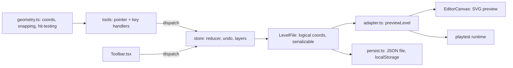
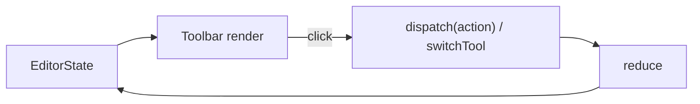

# Level editor: design breakdown

Dev-only authoring tool for Notehead levels, at `/toolkit/games/notehead/levels/`. It writes `<id>.level.json` files. The game does not read them. A playtest mode runs a level in a sandbox using the game's own physics.

This document records why the key pieces are built the way they are, and what would change that decision.

## Map

Three rules hold the design together:

1. **One authored model.** `LevelFile` (logical space, +y up, 900x1600) is the only thing that is saved. Everything else is derived from it or is transient.
2. **Tools never mutate the level.** They dispatch actions. The reducer owns undo.
3. **Reuse the game's code, not a copy of it.** Preview and playtest call the game's own sim and art. The editor does not re-implement physics or rock rendering.

## geometry.ts

### What it is

Pure functions, no React, no state. Five jobs:

| Job | Functions |
| --- | --- |
| Coordinate spaces | `toView`, `fromView`, `scaleOf`, `viewSizeOf`, `outerRect` |
| Snapping | `snapToGrid` |
| Segment and polygon math | `distToSegment`, `pointInPolygon` |
| Terrain closing | `terrainOutline` (with `boundaryProject`, `perimeterT`) |
| Hit-testing | `findEnter/Borealis/BandEnd/BandBody/Exit/TerrainVertex/TerrainSegment/TerrainBody`, `hitTest` |

### Why it is hand-written

- **The coordinate math must be the game's math.** `toView` and `fromView` wrap `toSvg` and `fromSvgPoint` from `sim.ts`. A level drawn here has to land where the game puts it, to the pixel. A generic library would give us a second transform to keep in sync.
- **Landscape space is anisotropic.** Logical 900x1600 maps to a 360x200 view with different scale on each axis. A circle of pick radius in logical space is an ellipse on screen. So all snapping, tolerances and distances are measured in view units, which are what the person sees. Most libraries assume one uniform scale.
- **The sizes are tiny.** A level has dozens of items. Linear scans in `hitTest` cost nothing. A spatial index would be complexity with no payoff.
- **Zero dependencies, fully testable.** Every function runs in node under vitest with no DOM.

### If a regular dev found a library for this: how the library authors would explain it

The honest framing: these libraries are right for a different problem. Each would say roughly the following.

| Piece | Library a dev might reach for | How its authors would explain it | Why we did not use it |
| --- | --- | --- | --- |
| `toView` / `fromView` | `DOMMatrix` / SVG CTM, d3-scale, Paper.js `Matrix` | "A transform is an affine matrix. Compose translate, scale and rotate, invert it for the reverse, and every shape in the scene shares one pipeline." | Ours is one fixed flip-and-scale per region, and it already exists in `sim.ts`. A matrix would be a second source of truth. The editor does use the live SVG CTM for pointer-to-view conversion, which is the right place for a matrix. |
| `snapToGrid` | tldraw / Excalidraw snapping | "Snapping is a set of snap targets with a pixel threshold. You collect candidate points, pick the nearest within threshold, and show guides." | Our only target is a fixed view-space grid. |
| `distToSegment`, `pointInPolygon` | Turf (`nearestPointOnLine`, `booleanPointInPolygon`), `point-in-polygon` | "Point-in-polygon is ray casting with edge cases for points on the boundary. Distance to a line is projection clamped to the segment. We handle geodesic input and holes." | Same algorithms, minus the generality. Ours is 15 lines of ray casting and one clamped projection. Turf would add geodesic handling we do not use. |
| `hitTest` | Paper.js `hitTest`, Konva `getIntersection`, tldraw `Geometry2d.hitTestPoint` | "Every shape reports its own hit area. The scene walks them in z-order, with a margin, and returns the first hit." | We do this too, but the priority is by size of target, not z-order: markers, vertices, band ends, bands, exits, segments, then rock fill. Without that, rock fill would swallow every click on a vertex drawn over it. |
| `terrainOutline` | `polygon-clipping`, Clipper, Turf `polygonize` | "Closing and combining shapes is a boolean operation on polygons. Use a robust sweep so self-intersections and degenerate input are handled." | Our rule is not a general boolean op. It is a game rule: an open line is finished off-frame by walking the frame border clockwise, so rock sits on the right of the drawing direction. That rule has no library equivalent. |

Where a library would genuinely win, and when to switch:

- **Curved terrain** (bezier or spline edges): bring in Paper.js or bezier-js for hit-testing and flattening.
- **Hundreds of shapes**: add an R-tree (`rbush`) so `hitTest` is not a linear scan per pointer move.
- **Union / subtract of rock** (carving caves): use `polygon-clipping` or Clipper. Hand-rolling robust polygon booleans is a known trap.
- **Self-intersection validation**: today `validateLevel` does not reject a terrain line that crosses itself. A library like Turf's `kinks` would add that check.

### Design choices worth knowing

- **Tolerance in view units, with floors.** Markers use `max(tol, MARKER)` so they stay pickable when zoomed far out.
- **Open-line closing.** `boundaryProject` pushes each end to the nearest frame edge. `perimeterT` turns a border point into a distance along the perimeter. The ring then adds any corners between the two ends, walking clockwise. Rock is on the right of the drawing direction, so a floor drawn left to right has rock below it. `F` flips the side.
- **Bleed area.** `outerRect` extends past the frame by `OVER = 16` (plus the zig camera pad in landscape), matching how far the game draws rock past the frame.
- **Layers in the hit path.** `editable(layers, id)` is checked inside `hitTest`. A hidden or locked layer cannot be picked, so the toolbar needs no hit-test logic of its own.

### Known limits

- `findTerrainBody` rebuilds each outline per hit-test call. Fine at this size, wasteful at scale.
- No self-intersection check on drawn terrain.
- `pointInPolygon` treats points exactly on an edge as undefined. The vertex and segment finders run first, so in practice this does not matter.

## adapter.ts

### What it is

A one-way, pure conversion from the authored `LevelFile` to the game's runtime shapes: `Mass`, `Ledge`, `Borealis`, `FrameOpening`, `ExitZone`, `Body`. `previewLevel(level, { ticks })` returns all of them at once.

### The pattern

This is the Adapter pattern at a boundary, sometimes called an anti-corruption layer. Two models exist for good reasons and should not leak into each other:

| | Authored model (`LevelFile`) | Runtime model (game types) |
| --- | --- | --- |
| Space | Logical, +y up | Mix of logical and view space (masses are view space) |
| Purpose | Saved, versioned, diffed in git | Drawn and simulated every frame |
| Extra fields | None. Only what a designer decides | `collected`, `homeX`, `restingOn`, computed score marks |
| Stability | `version: 1`, parsed strictly | Free to change with the game |

If the file stored runtime shapes, every game refactor would break saved levels. If the game consumed authored shapes directly, it would carry editor concerns. The adapter is the single place where the two meet.

### Key decisions

- **Derive, do not store.** Rock outlines and score marks are computed from the drawn points. The file stores only the points, a `closed` flag and a `tickSeed`.
- **Determinism through `tickSeed`.** The game's `scoreMarks` takes a seeded random source. The file stores a seed derived from the shape id (`hashSeed`, FNV-1a). The same file always draws the same rock marks, in the editor, in the playtest and later in the game.
- **Preview equals game.** `scoreMarks` is exported from the game module and called as is. What you see is what the game's drawing code produces, not an approximation.
- **Tick cache.** Mark generation is the expensive part. A small keyed cache (64 entries, keyed by view, closed flag, seed and the ring's points) avoids recomputing unchanged shapes.
- **`ticks: false` during drags.** Terrain edits change the ring on every pointer move, so the canvas turns marks off for the gesture and regenerates them on release. Dragging stays smooth.
- **It is the seam for two consumers.** The editor canvas and the playtest runtime both call `previewLevel`. When the game later reads authored levels, this is the conversion it needs.

### Known drift risk

`zoneFromExit` re-states the chevron placement that lives in `exit-zone.ts` (inset 12 or 20, edge at `width - 8`, arrow at `width - 26`, and so on). If the game changes those constants, the preview drifts silently. The clean fix is to export the placement from `exit-zone.ts` and have the adapter call it. `down` exits return `null` because the game has no art for them.

## Toolbar.tsx

### Ideology

The toolbar is a **controlled view over a store**. It holds no state, owns no rules, and contains no hit-testing. It receives `store` and `state`, renders from `state`, and sends intent with `store.dispatch` or `switchTool`.

This is unidirectional data flow, the same shape as Redux or Elm, in about 40 lines of store code (`createEditorStore`).

### Decisions

- **Tools are data, not JSX.** The buttons come from `TOOL_ORDER.map(id => TOOLS[id])`. A tool declares its `label` and `hotkey`. Adding a tool means adding a file to `tools/` and one entry in the registry. The toolbar does not change.
- **One path for click and key.** A button click calls `switchTool`, the same function a hotkey calls. Both cancel any gesture in progress the same way. Two paths would drift.
- **Rules live in the reducer, not the UI.** Visibility and lock are plain state. Their effect (a hidden layer cannot be picked) is enforced in `hitTest`. While a playtest runs, the reducer refuses every action except stopping or loading. The toolbar then needs only `inert` and a dimmed look, with no per-button guards.
- **Custom store, not a library.** `createEditorStore` is `getState`, `dispatch`, `subscribe`, read through `useSyncExternalStore`. That keeps the store usable without React, so tool tests run in node through a harness that drives the same functions the canvas calls. Zustand or Redux Toolkit would work, but would add a dependency for what is now a 40-line file.
- **Undo is a reducer feature.** `past` and `future` stacks, with `live` edits and `base` so one drag is one undo step. The toolbar's buttons only dispatch `undo` and `redo`, and read `past.length` and `future.length` to disable themselves.
- **Accessible by default.** `role="toolbar"`, `aria-label`, `aria-pressed` on toggles, `aria-label` on icon-only buttons, and `title` carrying the shortcut.
- **Plain Tailwind, no component kit.** Dev-only tool, so a shared `button` class string and `clsx` are enough.

### Known smells

- `const env = { tolerance: 3 }` is repeated in `Toolbar.tsx` and `LevelEditor.tsx`, and the canvas has its own `PICK_PX`. These should become one exported constant.
- The file is about 190 lines and holds five separate sections (Play, Tools, History, Snapping, Layers). If it grows, split into `ToolPalette`, `HistoryControls`, `SnapControls` and `LayerList`. The props already allow that without changing the data flow.
- `Toolbar` imports `playBlocker` from the playtest runtime to explain why Play is disabled. That is a presentation concern reading a pure function, which is fine, but it is the one place the toolbar knows about a rule.

## Playtest sandbox (summary)

- `playtest/runtime.ts` is pure. It builds a scene from `previewLevel`, then steps the game's own `step`, `resolveMassesAgainst`, `stepBorealis` and `containAgainstOpenings`.
- It never reads the game's region registry or progress. A test snapshots `massesFor` for every region before and after a run to prove it.
- The only game-file change is `resolveMassesAgainst` in `collide.ts`, with a test showing it matches `resolveMasses` for every region.
- `PlaytestView.tsx` draws its own SVG using the game's art components. It does not use `SceneFrame`, because `SceneFrame` reads rock from the global registry.

### Play mode tools and HUD

- **Session, not level.** `EditorState.play` (`PlaySession`) holds Anachrometer on/off, display Hull and Tonation, the Borealis cursor toggle, Borealis added during play and the selected one. It resets on every Play and every Stop and is never written to the level file. `session` and `gem` actions pass the "frozen while playing" gate in `store.ts`; level edits still do not.
- **Toolbar.** Sandbox tools and Play tools are two panels in one CSS grid cell. The hidden one is transparent, shifted aside and `inert`, so the swap is a pure CSS transition (about 200 ms, small stagger, off under `prefers-reduced-motion`). History, Snapping and Layers stay dimmed and inert while playing.
- **Anachrometer.** The runtime reuses the game's helpers (`engageWarp`, `followWarpBand`, `canWarp`). A press mid-flight, with the toggle on, holds a band under the ship; the loop runs the ship at `WARP_TIME_SCALE` while Borealis keep real time (`tickBorealis`). The warp band is a cue, not a surface. Release launches from it; a tiny pull lets go; touching a real surface drops it.
- **Borealis cursor.** Click on empty space adds, click on a gem selects, double-click removes. The rules are pure functions in `playtest/cursor.ts`. Only added gems can be edited; the level's own stay put. Sidebar section "Playtest Borealis" edits pitch (A3 to E5) and position, a "New gem pitch" select sets what the cursor places, and `syncExtras` moves the running gems without resetting the ship.
- **Hull and Tonation are display values.** Nothing in a flight spends hull or tonation. The HUD reuses the game's `.notehead-tonation` and `.notehead-hull` classes so it reads like the real one.

### Routes: several levels, one sandbox

- **Library.** `EditorState.library` holds every level of the route and `activeIndex` the open one. `state.level` is still the single thing the canvas and tools edit; `syncLibrary` (one choke point in `reduce`) keeps `library[activeIndex] === state.level` after every action, so edit, undo and redo all land in the route with no per-action bookkeeping. Opening another level (`selectLevel`, `addLevel`, `removeLevel`, `loadRoute`) starts fresh history for it, so undo never crosses levels.
- **Explicit links.** An exit may carry `to`, the id of the level it leads to (`ExitOpening.to`). Absent means a dead end, exactly as before, so single level files are unchanged. Links are by id, not by list position, so a route can be a graph and reordering the list never rewires it. Renaming a level retargets the exits that pointed at it (in the same reducer step, so undo restores them). Duplicate ids are refused everywhere (import, Id field); a `to` naming a level that is not in the route is a warning, not an error.
- **Files.** Import takes any number of files, each a level or an array of levels, joined in the order given; any bad file or repeated id rejects the whole import (`parseLevelTexts`). Export JSON writes the open level; Export route writes one array file (`<first-id>.route.json`). Autosave stores the whole route and the open index under a v2 key and still reads the old single-level key once.
- **Editor UI.** The File section lists the route (click to open, drag to reorder, cross to remove; native drag and drop). The Route section under Level shows "Level n of m" and a "goes to" select per exit, with "Auto-link by order" filling empty targets (up and right to the next level, down to the previous). The selected exit has the same select.
- **Play across a door.** `advance` treats an exit with `to` as a door and sets `departed` instead of clearing. A door is never locked by Borealis or Tonation (a player may skip them at any time in the tutorial route); only an exit with no target still needs every Borealis ("Left early" otherwise). `playtest/route.ts` (pure) decides the landing: forward goes to the target's Enter point and velocity; back through a down door comes in through the target's own door that leads here (x or y kept inside that gap, falling or flying in), else the Enter point. The run's shots, hard hits, resets and clock carry over; Borealis added during play stay with the level they were added in. `R` restarts the level, Shift+R restarts from the level Play was pressed on. "Level cleared" shows only at an exit with no target.
- **Origin and keys.** `EditorState.originId` is the level the route begins on, even out of list order; null means the first level. It is set only in the Route section ("Set Origin"). P (and the Play button) plays from the open level; Shift+P plays from the origin. `EditorState.playFrom` records which level the running playtest began on and is what `PlaytestView` receives, so Shift+R restarts from there. A blocked start (for example the origin has no enter point) shows its reason as a short alert over the canvas for Shift+P. The origin follows renames, clears when its level is removed or a new route is imported, and rides along in the autosave but not in exported files. Shift+Command+arrow (Ctrl on Windows) opens the level the open level's exit facing that way leads to (`exitDestination` in `store.ts`); no exit that way, no target, or a target outside the route shows a short alert over the canvas ("No right exit"). Left never has an exit.
- **Not here.** Per-level progress is not remembered: a Borealis collected in one level is uncollected if you come back. The route is a sandbox for testing flow, not a save game.

### Pitch is a Borealis property only

Height used to map to a pitch (the game's launch ladder), which only made sense while levels were not connected. That mapping is gone: no pitch rows or ruler, no pitch snap, no auto pitch. Bands (`BandSpot`) carry no pitch; the adapter fills the game's required `Ledge.pitch` with one fixed value (`asLedge` in `model.ts`) that nothing in the physics reads. A Borealis is assigned a pitch from A3 to E5 (`BOREALIS_PITCHES`), chosen in the tool options or the Inspector, and a drag never changes it. Old files with a band pitch still load: `parseLevel` copies only known fields, so it is dropped.

### Incident: "Level cleared" the instant Play starts, and Play again does nothing

**Symptom.** Pressing Play showed the "Level cleared" modal at once, with 0 shots. "Play again" appeared dead: the modal came straight back.

**Evidence (runtime logs, not guesses).** The test level had no Borealis, and a down exit spanning almost the whole floor (x 18 to 774). The enter point was on or just above the floor.

- On the first frame (later, the second), `touchedOpening` was true for the down exit, with `clock` at 0 to 0.033.
- With 0 Borealis, `allCollected` is true, so any exit trigger counted as a clear.
- "Play again" did run. The log showed the click reaching the handler, a fresh `createState`, then the same `left detected` 1 to 35 ms later. The reset worked. The identical start cleared again, which looked like a dead button.
- Click delivery was not the problem. Window-level pointer logs showed `pointerdown`, `mouseup` and `click` landing on the button.

**Root cause.** Not a UI bug. The level was degenerate: a ship released above a floor-wide down exit falls into it before the player can act. The game's down exit fires when a falling hull touches the floor inside the gap, which is correct for the game's reverse routes, and the playtest reused it faithfully. "Play again" restarts from the same enter point, so it replays the same instant exit forever.

**Fix, and the one that failed.**

1. First attempt: block Play if the ship would trigger an exit on frame one. This was too narrow. Moving the enter point up a little moved the trigger to frame two, and the same symptom came back.
2. Final fix: `playBlocker` flies the level hands-off for up to 10 s (`exitsUnattended` in `playtest/runtime.ts`). If the ship leaves through an exit before it lands on any ledge, Play is disabled with "The ship flies out an exit before it lands on anything. Start it higher or away from the exit." This checks the real condition (nothing playable happens) instead of one frame of it. It uses the same `advance` loop as the run, so the check cannot disagree with the playtest.

**Design notes from this fix.**

- Validate by simulating, not by special cases. The first-frame test was a symptom check. The unattended flight is the property we actually care about.
- The Toolbar memoizes the check on the level and skips it during a drag, because it runs up to 600 simulation frames.
- `buildScene` only applies the static checks (valid file, enter point, exit). The flight check lives in `playBlocker`, so the playtest runtime and its tests can still build scenes for levels that are deliberately degenerate.
- A level with 0 Borealis still clears the moment the ship leaves through an exit. That is intentional (nothing to collect), but it is why this bug read as "cleared" instead of "left early".

## What is deliberately not here

- The game reading `src/features/notehead/levels/*.level.json`.
- Curved terrain, rock boolean operations, or a spatial index.
- Hull HP, story and audio in the playtest.
- A server. The app is a static export, so saving is a file download plus a `localStorage` autosave.
- The game reading route files. A route is an authoring and sandbox concept for now.
