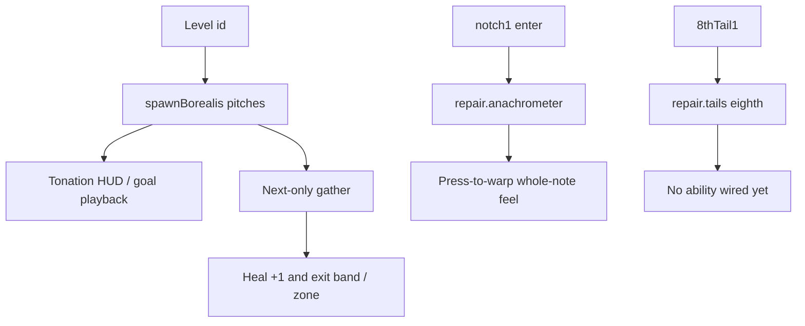

# Notehead — Tonation / Borealis resourcing

Research and design audit of game resources, musical learning, and Note-Tail abilities.

Companion to [`GAME_SPEC.md`](./GAME_SPEC.md), [`story-content.md`](./story-content.md), and [`modules/story.ts`](./modules/story.ts). If this file and the runtime disagree, treat this as the **design recommendation**; update `GAME_SPEC.md` before changing code.

**Scope of this pass:** report only. No gameplay code changes.

---

## Verdict

**Borealis and Tonation are effectively the same system today.** Tonation is the HUD projection of Borealis gather-order pitches. That collapse overloads three jobs — visit gate, melodic phrase, and HP heal — into one ordered pickup chain.

That makes sense as **early scaffolding** (one glowing “next” target, one heard phrase). It does **not** make sense as the permanent identity of both the energy resource and the musical lesson. Students mostly learn path-following; the latent interval/arpeggio content is under-extracted.

**Target stance:**

- Keep **Tonation** as ship jargon for the *phrase* (pair with plain theory labels).
- Keep **Borealis** as energy / spatial visits.
- Treat **Note-Tails** as an **ability kit** where each Tail unlocks a verb *and* a level structure family — duration still flavors how long the Captain owns control, but pedagogy rides on the region type (staff lanes, sticky diagonals, beat-synced mazes), not gem order alone.
- **Deprecate** “Tonation chains” as a difficulty / timed-gather mode (see §4).

---

## 1. Current system map

Four related systems as implemented:

| System | Role today | Source |
| --- | --- | --- |
| **Borealis** | Ordered mid-air energy / visit markers. Next-only magnetize & collect; full gather heals +1 HP, plants exit Frequency Band, lights exit zone. | [`modules/borealis.ts`](./modules/borealis.ts) |
| **Tonation** | Derived HUD pitch list via `tonationPitches()` — Borealis pitches in gather order, or the region’s single guide pitch. Goal button plays the chain. | `tonationPitches` → HUD in `NoteheadApp` |
| **Anachrometer** | Mid-air press-to-warp: slow ship physics, place transient Frequency Band, re-pull. Granted by a level's events (`grant.anachrometer`, `notch1` in the tutorial route) via `repair.anachrometer`. Whole-note hull bleach while warping. **Not** stored in `tails[]`. | [`modules/anachrometer.ts`](./modules/anachrometer.ts) |
| **Note-Tails** | Inventory strings on `repair.tails`. Only `"eighth"` is collectible (`8thTail1`, via `LevelEvents.noteTail`). **No ability code reads the array yet.** | [`modules/note-tail.ts`](./modules/note-tail.ts), `progress` |

### Pitch chains on the route

| Level | Tonation / Borealis | Musical reading | What play trains today |
| --- | --- | --- | --- |
| `notch1` | E4 → A4 | Perfect 4th (degrees 3→6) | Pocket then block path |
| `stairs1` | C4 → E4 → G4 | **C major arpeggio** (1–3–5) | Bottom → top tread hops |
| `zig1` | C4 → E4 → A4 | 1–3–6 contour (Am-ish / C6 without G) | Float → left → right zig |
| Levels without Borealis | Single guide (launch/stairs `G4`, notch/zig `A4`) | One target tone | Aim / clear without a phrase |

Stairs is the only chain that cleanly teaches a triad. Notch and Zig still carry interval content — but only if named and replayable, which the current loop does not do.

---

## 2. Does order-only Borealis make sense?

**Yes as early scaffolding. No as the permanent fusion of resource + phrase + heal.**

### What works

- One legal next gem matches Simply Piano–style “next note unlocks next” and keeps K–2 / Easy route readable.
- Magnetism + pitch-on-collect gives immediate aural feedback without Tone.js.
- Visit-as-collect lets the Captain stay airborne with Anachrometer instead of landing on every ledge — good for the warp fantasy.
- Dimmed later gems (live UI opacity ~0.28) make order visible without a second tutorial layer.

### What fails pedagogically

- **Progress + fuel + phrase** share one pickup. Players chase heal / exit, not intervals.
- Forced sequence without (a) naming the leap/chord, (b) free-order replay, or (c) same contour from a new tonic trains **rote path following** — closer to Piano Tiles than Chrome Music Lab.
- StartScreen still advertises Easy/Medium “No Tonation chains” / Hard “Tonation can chain.” That came from an older timed-gather idea and is **slated for deprecation** — gather order is always enforced today and should not stay as fake difficulty flavor.

### Live UI evidence

On Hard, Stairs shows `tonation: C4 E4 G4` beside `borealis 0/3` with only the first gem lit. Zig shows `C4 E4 A4`. The two HUD widgets look like separate resources; the data model makes them one list.

---

## 3. Benchmarks

### Music apps / rhythm games

| Analogue | Pattern | Lesson for Notehead |
| --- | --- | --- |
| **Simply Piano / Yousician** | Next-note gating; curriculum unlocks | Excellent for route teaching; weak transfer to interval naming unless the UI names the leap |
| **Piano Tiles** | Single legal next tile | Pure sequence → almost no theory |
| **Rock Band / Amplitude** | Pitch-height highways | Contour-as-space matches the diatonic height ruler; star-power-as-heal can turn music into score farming |
| **NecroDancer / Beat Saber** | Act on the pulse | Teaches timing / pulse, not pitch intervals |
| **Patapon** | Call-and-response phrases as verbs | Phrase memory as *ability* — closer to Note-Tails than to Borealis crumbs |

**Takeaway:** Sequence alone ≠ interval pedagogy. Label, contrast, and replay.

### Spatial pitch / education toys

| Analogue | Pattern | Lesson for Notehead |
| --- | --- | --- |
| **Chrome Music Lab Melody Maker** | Y = pitch, X = time | Already mirrored by Notehead’s height ruler — protect free contour exploration later |
| **Chrome Lab Arpeggios / Chords** | Chord tones made explicit | Stairs C–E–G *is* this without the word — say “arpeggio” |
| **Toca Band / open play** | No fail state | Don’t make every collectible a hard gate |
| **Singing coaches** | Continuous pitch match | Contour motor loop; don’t punish exploration with “only correct next gem” forever |

### Metroidvania ability gating

Hollow Knight / Metroid pattern: encounter lock → earn verb → teach room → reopen map. Notehead’s kit now maps verbs to **level structure families**, not only mid-air feel:

| Ability feel | Maps to Note-Tail | Level family |
| --- | --- | --- |
| Charged / long time ownership | **Whole / Anachrometer** | Current slingshot + warp regions (intervals / arpeggios) |
| Sticky cling / sustained contact | **Half** | Diagonal-launch caves; cling to terrain between pulls |
| Lane commit / beat pulse | **Quarter** | Staff-line “Temple Run” lanes (line vs space) |
| Short stealth bursts | **Eighth / Sixteenth** | Beat-synced sentry mazes (normal vs advanced subdivision) |

**Failure mode:** If tails only unlock “the next Borealis order chain,” they feel like keys. Each Tail must change the **verb** and open **new geometry**.

### Dual-purpose resources

| Analogue | Dual role | Lesson |
| --- | --- | --- |
| **Celeste strawberries** | Optional mastery; do nothing for story | Perfect tonation order should be optional, never exit-lock |
| **BotW spirit orbs** | Earn → bank → choose Heart or Stamina | Heal / capability should be a *spend*, not auto-fused to ordered gather |
| **Hades nectar** | Meta currency, not run HP | Keep relationship/meta sinks out of in-run survival when possible |

Notehead today fuses Mario-star-in-the-level + gym-badge order + mid-challenge heart drop. That is why Borealis risks feeling like breadcrumbs.

---

## 4. Terminology: “Tonation”

| Term | Standard meaning | Notehead use |
| --- | --- | --- |
| **Tonality** | System organized around a tonic | Easy to confuse with “tonation” |
| **Tonic** | Home pitch | Chains often start on C; Notch starts on E |
| **Arpeggio** | Chord tones in succession | Stairs C–E–G |
| **Scale degrees / contour** | Portable classroom language | Best HUD companions |
| **Tonation** | **Not** a standard theory term | Fine as **Captain / ship slang** |

**Recommendation:** Keep Tonation as in-fiction jargon (“tonal calibration” already appears in story). Always pair HUD/teacher-facing copy with plain labels: “Arpeggio: C–E–G,” “Leap: E up to A,” “Contour: low → mid → high.” Do not ask students to treat “tonation” as vocabulary for the quiz.

### “Tonation chains” — deprecate

Origin: an older idea that some levels would force gathering Borealis (or another resource) on a **time limit**, “chaining” pickups together, with Easy/Medium skipping that pressure and Hard enabling it.

**Revamp stance:** deprecate that mode. Do not implement timed Borealis chains as the Hard differentiator. Rewrite [`StartScreen.tsx`](./components/StartScreen.tsx) difficulty lines when the next UI pass lands (HP / aim / mastery copy instead). If a future mode needs pressure, prefer Tail-specific stakes (sentry beat windows, lane miss, cling stamina) over a global “chain Borealis before the timer” rule.

---

## 5. Note-Tails — ability kit + level families

Framing:

- The **eighth Note-Tail** is the reward for finishing the first set of regions (`8thTail1`).
- **All tails** may unlock new in-game functions and **their own level structures** later.
- The **Anachrometer is the function of the Whole Note-Tail** (a whole note has no stem/tail in notation; in Notehead lore it is the “whole” repair: longest sustained control of time).
- Duration still flavors control length; **musical focus rides on the region type** each Tail opens.

### Ability map (working plan)

| Tail | Verb / feel | Level structure | Musical focus (working) | Confidence |
| --- | --- | --- | --- | --- |
| **Whole (Anachrometer)** | Press-to-warp: deep slow-mo + mid-air Frequency Band; long commit | Current slingshot regions (Notch / Stairs / Zig pattern) | **Intervals + arpeggios** — name leaps; Stairs C–E–G as triad; transpose later | High — already in play |
| **Quarter** | Quad-directional movement; commit to a lane | **Staff-lane runner** (Temple Run–style): lines vs spaces as lanes; stay on the correct staff position to collect / interact with the target note | **Staff reading** — line vs space, step vs skip as lane changes, contour as lane sequence | High concept; needs lane prototype |
| **Half** | Ship **sticky to terrain**; cling / slide; diagonal launches between cling surfaces | Similar caves / cliffs to current route, but challenges require **diagonal aim** and cling resets instead of soft-band-only play | **Open** — strongest candidates below; needs a pick | Medium — verb clear, pedagogy thin |
| **Eighth** | Short **stealth bursts** (subdivision-length invuln / quiet window) | **Maze** with stationary sentries; enemy patrols / turns on predetermined, **beat-synced** intervals (quarter turns, half-circle arcs, etc.) | **Pulse + subdivision** — move in the holes between beats; hear the enemy “meter” | Medium — needs maze engineering |
| **Sixteenth** | Advanced form of eighth: tighter burst window / denser patrol grid | Same maze family, harder subdivision | **Faster subdivision / denser meter** | Medium — unlock after eighth fluency |

### Half — musical attachment candidates (pick later)

Half’s cling verb is strong; the classroom hook is not locked yet. Candidates to pressure-test:

1. **Held tones / sustain** — while clinging, a held pitch drones; release to launch cuts the sustain (half-note = stay on the pitch).
2. **Slurs / phrasing** — cling path = slurred gesture; launching off = phrase break. Collect Borealis only while a slur is “open.”
3. **Harmonic intervals** — cling on one surface (root) while a second tone sounds on a facing wall; diagonal launch “resolves” or completes the interval.
4. **Ties across the bar** — cling must last through a barline marker before the exit band arms (visual barline on the cliff).

Recommend prototyping (1) or (3) first; (2) and (4) need clearer UI affordances.

### Eighth / Sixteenth — maze notes

- Sentries are **readable meters**, not aggro AI: telegraph turn on a fixed subdivision so students can count.
- Eighth burst ≈ one eighth of cover; Sixteenth ≈ half that window or twice the patrol density.
- Musical win condition should include **hearing** the patrol (click / pitch on each sentry step), not only seeing cones.
- Mazes are a new terrain family — expect separate art, collision, and beat tables from the portrait slingshot route.

### Quarter — staff-lane notes

- Lanes = staff lines *or* spaces (toggle teach: “line notes” vs “space notes” worlds).
- Target notes ahead announce the required lane (HUD tonation + lane highlight).
- Quad-directional: up/down change lane (step/skip), left/right progress the runner — or portrait staff with vertical = pitch if that reads better on tablets.
- This is the cleanest **notation literacy** Tail; keep slingshot physics optional or secondary here so the lesson stays staff, not aim cones.

### Design rules

1. Each Tail opens **new geometry** *and* a new **verb** (not only a Borealis key).
2. Teach room immediately after unlock (Notch calibrate pattern for Anachrometer; same for each new Tail).
3. Never make a Tail *only* “required to pick up the next Borealis type.”
4. Visual/audio: Tail silhouette + distinct SFX length / timbre so the value is **heard**.
5. Data model: eventually treat Anachrometer as a whole-note function in the same kit as `tails[]`, without breaking the current unlock beat.
6. Expect **separate level structures** per Tail family; the first-route MVP stays Whole-centric until each family has a prototype beat.

**Today’s gap:** `"eighth"` is written to `repair.tails` and never read for gameplay. Ship stays stemless; warp only adds the whole-note hole. Lore GI (“Borealis … repair the Note-Tails and gain new abilities”) oversells the coupling.

---

## 6. Implemented resource split (banked Tonation)

Live in code / `GAME_SPEC.md` (supersedes earlier “any-order-for-exit-only” draft):

### Roles

| Role | Borealis | Tonation | Note-Tail |
| --- | --- | --- | --- |
| Visit / exit gate | Any-order collect; **does not** gate exit | — | Eighth Tail needs Tonation + hull gates |
| Melodic phrase | Plays pitch on collect / tap-preview | Banked only on **correct interval order** (once per beat) | — |
| HP | — | Hard breach wipes bank | — |
| Energy meter | — | Solid HUD bar 0–24 | — |

### Practical rules (shipped)

1. **Exit always available** on interval beats — skip freely; retry Borealis after regen on re-enter.
2. **Tonation payouts:** Notch +5, Stairs +9, Zig +10 (cap 24). Wrong order fails the attempt.
3. **Heal** on first region clear: Easy/Med +3, Hard +1.
4. **Eighth Tail:** Easy/Med ≥19 Tonation; Hard ≥24. Med hull ≥2; Hard ≥3.
5. StartScreen copy drops “Tonation chains”; uses Tail thresholds + breach wipe.

### Pedagogy checklist

**Whole / Borealis beats**

- [x] Interval HUD names the challenge pair (Ascending 4th / progressive arpeggio pairs).
- [x] Exit free of Borealis order; Tonation requires correct pitch sequence.
- [x] HP heal not tied to perfect sequence (tied to region clear).
- [ ] Same contour, new starting height (transposition) at least once.
- [ ] Pair “Tonation” slang with plain classroom language in GI / teacher notes.

**Per-Tail families (when prototyped)**

- [ ] Quarter: line vs space lesson explicit; lane = staff position.
- [ ] Half: lock one musical attachment (sustain, slur, harmonic interval, or tie) before building a full cave.
- [ ] Eighth: sentry steps audible on a fixed subdivision; burst length matches the named value.
- [ ] Sixteenth: same maze grammar, denser meter — teach as “twice as fast,” not a new verb.

---

## 7. Spec / story / UI contradictions

| Topic | Spec / story / UI | Runtime | Action |
| --- | --- | --- | --- |
| **Tonation chains** | Was StartScreen Easy/Med “No…”, Hard “can chain” | Replaced with Tail thresholds + breach wipe copy | Done |
| **HP dials** | GAME_SPEC Difficulty table Easy 8 / Med 5 / Hard 3; Hull section + code **10 / 8 / 5**; StartScreen Hard “Only 5 HP!” | `PROFILES.maxHp` 10/8/5 | Align Difficulty table to Hull/code |
| **Borealis → abilities** | Exit GI: orbs repair calibration so you can repair Note-Tails / gain abilities | Borealis heals +1 and unlocks exit; tails unlock separately | Soften lore or wire a real spend sink |
| **Anachrometer unlock timing** | CM on `notch-calibrate` enter dramatizes divert-power repair | Flag already `true` from `notch-crash` evaluate | Accept as narrative reboot, or move flag flip |
| **MVP tails** | GAME_SPEC lore: “MVP only implements the Anachrometer”; type omits `8thTail1` | Tail beat + inventory write exist; no ability | Update spec types + lore |
| **Stairs story** | `story-content.md` draft (“tonal order”, Anachrometer tips) | Not in `story.ts` | Wire or mark deferred |
| **Eighth collect pitch** | No tonation entry on `8thTail1` (HUD G4) | Collect SFX hard-coded `A4` | Align SFX to goal or give the Tail its own tone |
| **Visited vs Borealis** | Clear was `visited` + Borealis | Exit is `crossedExit` only; Tonation is separate | Done |

`GAME_SPEC.md` says: if spec and code disagree, follow the spec. Several places **Hull section + tests + code** already agree against the Difficulty table — update the table rather than reverting HP.

---

## 8. Playtest notes

Verified on `localhost:3000/toolkit/games/notehead/` (dev server, Hard difficulty, beat-jump chrome):

| Check | Result |
| --- | --- |
| StartScreen difficulty copy | Easy/Med “No Tonation chains”; Hard “Tonation can chain” |
| Hard hull | `aria-valuemax` / pips = **5** |
| Launch tonation | Single **G4** (no Borealis counter) |
| Stairs tonation + Borealis | **C4 E4 G4** + **0/3**; gem `s1` bright, `s2`/`s3` dimmed (~0.28) |
| Zig tonation | **C4 E4 A4**; hint: float → left → right |
| Tail beat | Tonation **G4**; eighth Note-Tail pickup present; no Borealis counter |
| Hard gather rules | Unchanged from Easy/Med — still next-only (confirmed via code + Stairs gem dimming) |

Sandbox beat-jumps can leave launch-enter CM visible on later beats; treat as debug chrome noise, not route design.

---

## 9. Open decisions (keep iterating)

| Topic | Working lean | Needs |
| --- | --- | --- |
| Half musical hook | Sustain (1) or harmonic interval (3) | Classroom playtest of cling + audio |
| Quarter orientation | Portrait staff (vertical = pitch) vs landscape Temple Run | Tablet readability prototype |
| Eighth unlock order | Eighth after first Whole arc (`8thTail1`); Sixteenth later | Maze prototype before Sixteenth art |
| Borealis on non-Whole levels | Optional / reskin per family (lane orbs, maze cells) | Don’t force slingshot gem rules into staff/maze |
| Difficulty without chains | HP + aim + Tail-local density | New StartScreen lines |

---

## Bottom line

Notehead is a strong **Metroidvania + spatial Melody Maker** hybrid. Today Borealis does three jobs that Celeste, BotW, and Chrome Music Lab deliberately separate. Split **Tonation (phrase)** from **Borealis (energy/visits)**, deprecate timed **Tonation chains**, and treat Note-Tails as an **ability + level-family kit**: Whole = Anachrometer intervals/arpeggios; Quarter = staff-lane reading; Half = sticky diagonal caves (musical hook TBD); Eighth/Sixteenth = beat-synced stealth mazes. Duration still flavors control; pedagogy lives in the region grammar each Tail unlocks.
