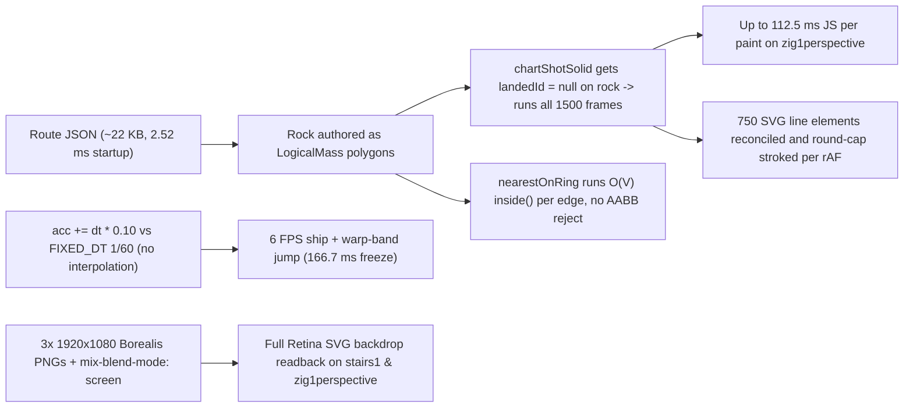

# Notehead Performance & Library Review (`v0.5` Route Architecture)

## Executive Summary

1. **The new route JSON / adapter system itself adds almost zero application weight.** `zig1perspective.route.json` is ~22 KB (`notch1.route.json` ~17 KB), and `loadRouteText("zig1perspective")` validates, builds, and registers all five level scenes in **2.52 ms** once on startup (cached thereafter in `routes/registry.ts`).
2. **Why Anachrometer feels laggy specifically on `stairs1` and `zig1perspective` comes down to three compounding runtime bottlenecks:**
   - **6 Hz Anachrometer timestep quantization (physics math):** Because `acc += dt * WARP_TIME_SCALE` (`0.10`) waits for a full `FIXED_DT` (`1/60` s) with no sub-step scaling or render interpolation, the ship and warp band only advance **once every 166.7 ms (6 FPS)** — freezing for 9 of 10 frames at 60 Hz (19 of 20 at 120 Hz) and jumping 7–10 px at once during high-speed mid-arc warps on `stairs1` and `zig1perspective`.
   - **Unterminated 1,500-frame trajectory lookahead + $O(V^2)$ polygon probes (`collide.ts`):** Moving from v0.4 hand-coded `Ledge` treads to closed `LogicalMass` rock polygons removed `landedId` early-exit when an aimed arc settles on rock. On `zig1perspective` (5 rock masses, 71 vertices), **46%–52% of aims simulate all 1,500 frames on every `requestAnimationFrame`**, averaging **13.93 ms** and spiking to **112.49 ms/frame** in JavaScript alone before handing **750 `<line>` SVG nodes** to React.
   - **`3 × 1920×1080` `mix-blend-mode: screen` Borealis textures inside one clipped `<svg>`:** `stairs1` and `zig1perspective` are the **only two levels with 3 Borealis gems** (`landing1`: 0, `notch1`: 2, `8thTail1`: 0). `notehead-borealis-collectible-main.png` is a `1920×1080` image (8.29 MB RGBA uncompressed) drawn into a ~115 px box with `mix-blend-mode: screen` and an infinite opacity animation inside the same `<svg clipPath>` as four `1920×1080` sky PNGs, forcing full-surface backdrop readback and re-rasterization on a ~2.7M-pixel Retina landscape canvas every frame.
3. **Library verdict:** Full rigid-body physics engines (`matter-js`, `planck-js`, `@dimforge/rapier2d-compat`) fight Notehead's bespoke one-way `BREAK_SPEED` bands, anisotropic landscape space, and 1,000-step synchronous trajectory previews. Fixing the timestep + precomputing polygon AABBs and outward normals (~40 lines, zero dependencies) drops JS physics/preview cost from **112 ms to < 0.4 ms**. On the rendering side, `NoteheadView` (`modules/view.ts`) is already a clean adapter seam: cropping the PNGs + collapsing `<Trajectory>` fixes SVG immediately, while a raw HTML5 `CanvasNoteheadView` (zero deps) or **PixiJS v8** (WebGL/WebGPU, if shaders/particles grow) can drop straight behind `NoteheadView` without touching `sim.ts` or `LevelFile`.



---

## 1. How the New Route System Affects Application Weight

| Metric | `notch1.route.json` | `zig1perspective.route.json` | Notes |
| --- | --- | --- | --- |
| Raw JSON size | ~17.4 KB | ~22.9 KB | Statically bundled; negligible gzip footprint (~4–5 KB) |
| Levels in route | 5 | 5 | `notch1`, `landing1`, `stairs1`, `zig1` / `zig1perspective`, `8thtail1` / `8thTail1` |
| Cold `loadRouteText()` time | ~2.1 ms | **2.52 ms** | Measured in Node v24; memoized in `loaded` Map (`routes/registry.ts:52`) |
| Minor startup duplication | `previewLevel` ×2 | `previewLevel` ×2 | `buildLevelScene` (`routes/scene.ts:49–53`) calls `buildScene(level)` (`ticks: false`) and then `previewLevel(level)` (`ticks: true`) |

### Per-Level Scene Complexity (`zig1perspective.route.json`)

| Level | View (`SvgViewSize`) | Rock Masses | Total Polygon Vertices ($V$) | Authored Bands | Borealis Gems | Exits |
| --- | --- | --- | --- | --- | --- | --- |
| `landing1` | `portrait` (`200×360`) | 2 | 27 (`[14, 13]`) | 1 | 0 | 2 |
| `notch1` | `portrait` (`200×360`) | 3 | 42 (`[9, 25, 8]`) | 1 | 2 | 1 |
| `stairs1` | `portrait` (`200×360`) | 1 | 13 (`[13]`) | 1 | **3** | 2 |
| `zig1perspective` | `landscape` (`554×308`) | **5** | **71** (`[7, 27, 8, 21, 8]`) | 1 | **3** | 4 |
| `8thTail1` | `portrait` (`200×360`) | 2 | 18 (`[10, 8]`) | 1 | 0 | 1 |

**Key takeaway:** The route system did not bloat memory or startup, but it **changed how level surfaces exist at runtime**. In `v0.4` (`StairCave`, `CanyonRun`, `ZigRun`), stair steps and shelves were `Ledge` objects (`kind: "step"` or `"block"`). In `v0.5`, every level has just **1 `Band`** and represents all stairs, shelves, pockets, and canyon walls as closed `LogicalMass` polygons. That representation shift directly triggered Bottleneck #2 below.

---

## 2. Bottleneck #1 — 6 Hz Anachrometer Timestep Quantization (Physics Math)

### Where It Happens
- Game loop: `portal/src/features/notehead/components/NoteheadApp.tsx` (lines 1069–1097)
- Editor playtest loop: `portal/src/features/levels/playtest/PlaytestView.tsx` (lines 198–204)

### The Math
`sim.ts` defines:
\[
\text{FIXED\_DT} = \frac{1}{60}\text{ s} \approx 16.67\text{ ms}, \qquad \text{WARP\_TIME\_SCALE} = 0.10
\]

In `NoteheadApp.tsx`:
```ts
acc += dt * timeScaleRef.current;
while (acc >= FIXED_DT && guard < 8 && ...) {
  acc -= FIXED_DT;
  tickSim(); // steps by full FIXED_DT (1/60 s of unscaled sim time)
}
paint(); // renders bodyRef.current directly — no alpha interpolation
```

When Anachrometer warp is engaged (`timeScaleRef.current = 0.10`):
- On a 60 Hz display ($\Delta t = 16.67\text{ ms}$), each frame adds $16.67 \times 0.10 = 1.667\text{ ms}$ to `acc`.
- `acc >= FIXED_DT` is true **only once every 10 display frames** ($\frac{16.67}{1.667} = 10$ frames = **166.7 ms = 6.0 Hz**).
- On a 120 Hz ProMotion display ($\Delta t = 8.33\text{ ms}$), `tickSim()` runs **once every 20 display frames** (still **6.0 Hz**)!
- For the 9 (or 19) frames in between, `bodyRef.current` and `warpRef.current` (`followWarpBand`) **do not move a single sub-pixel**, then jump a full `FIXED_DT` of unscaled velocity all at once.

### Why It Shows Up Worst on `stairs1` and `zig1perspective`
- On `notch1`, players typically engage warp near the vertical apex where $|v_y| \approx 0$, so a 6 Hz step moves $< 1\text{ px}$.
- On `stairs1` and `zig1perspective`, players warp **mid-arc while traversing horizontally/diagonally** across stairs or canyon gaps ($|v| \approx 800\text{–}1200\text{ logical/s}$). One unscaled `FIXED_DT` step is $13\text{–}20\text{ logical units} \approx \mathbf{7\text{–}10\text{ screen pixels}}$. Freezing for $167\text{ ms}$ and teleporting $8\text{ px}$ reads visually as severe 6 FPS physics lag, even when `requestAnimationFrame` itself is firing at 60–120 Hz.

### Clean Fix (Already Supported by `sim.ts`)
`step()`, `dockOnBand()`, and `slideOnStep()` in `modules/sim.ts` (lines 454, 491, 551) already clamp `const frame = Math.min(dt, FIXED_DT)`. Two complementary fixes make warp completely smooth at any refresh rate:
1. **Scale the step `dt` instead of starving the accumulator frequency:** accumulate real `acc += dt` at 60 Hz (`while (acc >= FIXED_DT)`), and advance `tickSim(FIXED_DT * timeScaleRef.current)`. During warp, physics updates at a true **60 Hz** with `dt = 1.667 ms` per tick instead of 6 Hz with `dt = 16.67 ms`.
2. **Render-pose interpolation (`alpha = acc / FIXED_DT`):** store `prevBodyRef` before each fixed tick and pass `lerpBody(prevBody, currBody, alpha)` to `paint()` so 120 Hz / 144 Hz displays never repeat frames in either normal flight or slow-mo.

---

## 3. Bottleneck #2 — 1,500-Frame Shot Preview Stalls & $O(V^2)$ Polygon Collision

### Where It Happens
- `chartShotSolid` & `nearestOnRing`: `portal/src/features/notehead/modules/collide.ts` (lines 55–123, 199–241)
- `chartShot`: `portal/src/features/levels/playtest/runtime.ts` (lines 463–494)
- Per-paint call site: `portal/src/features/notehead/components/NoteheadApp.tsx` (lines 621–631)

### Compounding Math Multipliers

1. **Missing rock-rest termination (`1,500` frames every rAF):**
   - `chartShotSolid` loops `for (let frame = 0; frame < 1500 && !landedOn; frame++)`.
   - `landedOn` is only set when `step()` lands on a `Ledge` (`result.landedId !== null && current.restingOn !== null`).
   - When the simulated ball hits a `LogicalMass` rock shelf, pocket, or flat rock top, `resolveOne` zeroes inward velocity (`vn < 0`) and returns `restingOn: null`. On the next simulated frame, gravity pulls it into the rock again, `resolveMasses` pushes it back out in **3 full passes**, and `landedOn` **never becomes truthy**.
   - Result: any aim whose arc comes to rest on rock runs **all 1,500 frames** (25 seconds of simulated physics) on **every single `paint()` call** — even while the player holds their pointer completely still during warp!
   - *(Parity bug noted during audit)*: `chartShotSolid` also does not call `containAgainstOpenings` (sealed level walls), whereas live `tickSim()` (`NoteheadApp.tsx:702`) and editor `chartShot` (`playtest/runtime.ts:263`) do.

2. **$O(V^2)$ raycast inside `nearestOnRing` (`collide.ts:64–88`):**
   ```ts
   for (let i = 0; i < ring.length; i++) {
     ...
     const dist = Math.hypot(point.x - px, point.y - py); // sqrt on every edge
     if (dist >= best.dist) continue;
     const len = Math.hypot(dx, dy) || 1;
     let nx = -dy / len;
     let ny = dx / len;
     const probe = { x: px + nx, y: py + ny };
     if (inside(probe, ring)) { // <-- O(V) raycast inside O(V) edge loop!
       nx = -nx;
       ny = -ny;
     }
   ```
   - Every rock polygon in `LevelScene` is **completely static** once loaded, yet `nearestOnRing` dynamically probes `inside(probe, ring)` ($O(V)$ raycast) multiple times per polygon per step to figure out which side of an edge faces outward.
   - `resolveOne` also runs `inside(center, mass.outline)` + `nearestOnRing(center, mass.outline)` on **every mass in the level with no bounding-box (AABB) check**. On `zig1perspective` (5 masses, 71 vertices), a stalled 1,500-frame preview performs **up to ~6.3 million edge operations and hundreds of thousands of short-lived `{ x, y }` object allocations in a single frame**.

3. **No memoization on unchanged aim/pose:**
   - `paint()` recomputes `chartShotSolid` unconditionally every rAF while `phase === "pulling" && power >= 0.08`, even when `(regionId, body.x, body.y, chartHome, aim.power, aim.angle)` has not changed since the last frame.

### Measured Benchmark (180 `(position, aim)` Samples per Level, Node v24)

| Level | Game `chartShotSolid` Stall Rate (`1500f`) | Game Avg JS | Game Max Spike | Playtest `chartShot` Stall Rate (`900f`) | Playtest Avg JS | Playtest Max Spike |
| --- | --- | --- | --- | --- | --- | --- |
| `landing1` | `0 / 180` (`0%`) | `0.83 ms` | `7.97 ms` | `1 / 180` (`1%`) | `0.89 ms` | `17.30 ms` |
| `stairs1` | `0 / 180` (`0%`) | `0.36 ms` | `7.98 ms` | `6 / 180` (`3%`) | `0.91 ms` | `22.71 ms` |
| `8thTail1` | `3 / 180` (`2%`) | `0.39 ms` | `11.09 ms` | `24 / 180` (`13%`) | `0.48 ms` | `3.96 ms` |
| `notch1` | `31 / 180` (`17%–25%`) | `4.25 ms` | **`68.47 ms`** | `139 / 180` (`77%`) | `11.35 ms` | **`43.35 ms`** |
| `zig1perspective` | **`82 / 180` (`46%–52%`)** | **`13.93 ms`** | **`112.49 ms`** | **`76 / 180` (`42%`)** | **`8.39 ms`** | **`115.31 ms`** |

At 60 Hz the entire frame budget (JS + React + style + layout + SVG raster + composite) is **16.67 ms** (**8.33 ms** at 120 Hz). A **40–112 ms** synchronous spike in `chartShotSolid` drops `zig1perspective` to **8–20 FPS** while aiming.

### Direct Math Fix (Zero Dependencies, >250× Speedup)
1. **Precompute `PreparedMass` once when building `LogicalMass`:**
   - Compute `minX, minY, maxX, maxY` AABB; in `resolveOne`, immediately return if `x < minX - SHIP_R || x > maxX + SHIP_R || y < minY - SHIP_R || y > maxY + SHIP_R` (4 float comparisons reject 80%–100% of non-adjacent masses).
   - Compute polygon signed area $2A = \sum (x_i y_{i+1} - x_{i+1} y_i)$ once and store each edge's unit outward normal `(nx, ny)` and `invLenSq` in flat typed/numeric arrays. `inside(probe, ring)` and `Math.hypot` inside the loop disappear completely ($O(V^2) \to O(V)$ with zero heap allocations).
   - Only run `inside(center, ring)` when `near.distSq < SHIP_R * SHIP_R` OR `center` is strictly inside the interior AABB (`minX..maxX, minY..maxY`).
2. **Stop lookahead on rock stall + cap preview horizon:**
   - Track `travelledSq = (x - prevX)^2 + (y - prevY)^2`; if `!current.restingOn && travelledSq < 0.25` for `6` consecutive frames (ball has settled/wedged on rock), break out of `chartShotSolid` / `chartShot` immediately (just as `playtest/runtime.ts` already does for live gameplay via `STALL_STEP`).
   - Cap `chartShotSolid` to ~`480–600` frames (8–10 s of flight is already longer than any single arc across a 900×1600 world).
3. **Memoize the last computed chart** on `(regionId, chartHome, round(body.x, 2), round(body.y, 2), round(aim.power, 4), round(aim.angle, 4))`.

---

## 4. Bottleneck #3 — React-SVG Reconciliation & `1920×1080` `mix-blend-mode` Rasterization

Even when JS math is fast (such as on `stairs1` in the main game where `chartShotSolid` averages `< 1 ms`), **browser rendering and compositing** do heavy extra work specifically on `stairs1` and `zig1perspective`:

### 4.1 Oversized `1920×1080` PNG Textures + `mix-blend-mode: screen` (`Borealis.tsx`, `Sky.tsx`, `notehead.css`)

| Asset File | Disk Size | Pixel Dimensions | Uncompressed RGBA | Instances in `<svg>` | Blend / Filter / Animation |
| --- | --- | --- | --- | --- | --- |
| `notehead-space-bg-seamless.png` | 3.6 MB | `1920 × 1080` | 8.29 MB | **2** (`Sky.tsx:162,170`) | Continuous CSS transform (`notehead-sky-crawl`) inside `<clipPath>` |
| `notehead-haze-30-opacity.png` | 2.2 MB | `1920 × 1080` | 8.29 MB | 1 (`Sky.tsx:181`) | `opacity: 0.1` full-frame `<image>` |
| `notehead-black-star-flecks.png` | 11 KB | `1920 × 1080` | 8.29 MB | 1 (`Sky.tsx:182`) | `opacity: 0.5` full-frame `<image>` |
| `notehead-borealis-collectible-main.png` | 297 KB | **`1920 × 1080`** | **8.29 MB** | **3 on `stairs1` & `zig1perspective`** | **`mix-blend-mode: screen`** + infinite `opacity` keyframes (`notehead.css:896–901`) |

Why this hurts `stairs1` and `zig1perspective` specifically:
- **`stairs1` and `zig1perspective` are the only levels with 3 Borealis gems** (`landing1`: 0, `notch1`: 2, `8thTail1`: 0).
- `notehead-borealis-collectible-main.png` is a full `1920×1080` canvas whose visible orb occupies only the center fraction, downsampled into a `56×56` view-unit rect (~115×115 CSS px).
- Applying **`mix-blend-mode: screen`** (`notehead.css:896`) to SVG `<image>` elements inside `<g clipPath="url(#nh-frame-...)">` (`SceneFrame.tsx:57`) prevents GPU layer isolation in Blink/WebKit: the compositor must read back the underlying sky + rock backdrop and re-composite the entire clipped SVG backing store (`~2212 × 1230` Retina physical pixels = **2.72M pixels** on landscape, **2.5×–3.2× larger** than portrait) whenever `<Ship>`, `<Band>`, `<Trajectory>`, or `.notehead-borealis` mutates.

### 4.2 750 Individual `<line>` DOM Nodes in `<Trajectory>` (`Trajectory.tsx:26–40`)
- When `chartShotSolid` emits up to 751 points, `Trajectory.tsx` renders **750 separate `<line className="notehead-chart" />` elements** with `stroke-linecap: round` and individual `opacity={fadeAt(t)}` attributes, calling `.toFixed(1)` 3,000 times per rAF.
- React diffs 750 VDOM nodes and mutates ~3,750 SVG DOM attributes per frame; the browser SVG engine recomputes bounding boxes and tessellates 1,500 round endcaps per frame.
- Replacing 750 `<line>` elements with **1 `<path>` stroked by a `<linearGradient>` fade** (or 4–5 bucketed `<path>` segments by opacity tier) cuts SVG DOM node count and attribute churn by **>99%**.

### 4.3 Always-Hot React `root.render()` & Secondary View Churn
- **`SvgNoteheadView.tsx` + `NoteheadApp.tsx` (lines 1023–1033, 1112):** `paint()` calls `this.root.render(<SceneArt ... />)` on **every rAF tick (60–120 Hz)** even when `screenPhase === "start"`, when a story cutscene is open, or when `phase === "idle"` and nothing in the scene has moved.
- **Strict Mode double-root race (`SvgNoteheadView.tsx:57, 121`):** `unmount()` defers `root.unmount()` via `queueMicrotask`, so React 19 Strict Mode's synchronous remount calls `createRoot(host)` on the same `host` `div` before the first root unmounts (surfacing the dev warning seen in Next.js Dev Tools). Creating an inner wrapper element per `mount()` eliminates the collision.
- **Editor `PlaytestView.tsx` (lines 228, 302, 379–386):** During Anachrometer drag in the editor playtest, `onPointerMove` calls `setPull(...)` *and* the rAF loop calls `setFrame(...)` (triggering two full React renders per frame), while `pathOf(mass.outline, true)` and `mass.ticks.map(pathOf)` rebuild SVG path strings every render without `useMemo`.

---

## 5. Re-Evaluating Libraries Under the Current Framework

Now that Notehead has two clean architectural seams — **`LevelFile` → `adapter.ts` → `LevelScene`** (data/physics boundary) and **`NoteheadView` in `modules/view.ts`** (`mount`, `resize`, `frame`, `unmount` rendering boundary) — we can evaluate third-party libraries cleanly by layer instead of tangling them into game rules.

### 5.1 2D Physics Engines (`matter-js`, `planck-js`, `@dimforge/rapier2d-compat`)

| Library | Gzip Size | Fit for Notehead | Verdict |
| --- | --- | --- | --- |
| **Keep custom `sim.ts` + optimized `collide.ts`** | **0 KB** | Exact match for musical/arcade rules | **Recommended** |
| `matter-js` | ~28 KB | Poor: impulse solver is non-deterministic across sub-steps; requires `poly-decomp` for concave rock (`stairs1`, `zig1perspective`) | **Do not adopt** |
| `planck-js` (Box2D) | ~36 KB | Medium: supports edge chains, but cloning/stepping a Box2D world 600–1,500 times per rAF for `chartShotSolid` is heavier than 1 circle vs static segments | **Do not adopt** |
| `@dimforge/rapier2d-compat` | ~600 KB (WASM) | Fast C++/Rust broadphase, but async WASM init complicates synchronous route tests + static export, and adds 600 KB for 1 moving circle | **Overkill** |

**Why rigid-body engines are the wrong tool here:**
Notehead has **1 moving circle (`SHIP_R`)** and **0 dynamic rigid-body-to-rigid-body interactions**, paired with bespoke rules that standard solvers do not natively model:
- One-way `Band`s that catch *only* while falling slower than `BREAK_SPEED` (`sim.ts:439`), then magnetically center-dock (`dockOnBand`).
- Sloped treads that kill bounce and drip off lips (`slideOnStep`).
- Anisotropic landscape coordinates (`900×1600` logical space mapped to `554×308` view space).
- Synchronous multi-hundred-step lookahead simulation (`chartShotSolid`) inside every aim preview.

### 5.2 Spatial Indexing & Narrow-Phase Geometry (`flatbush`, `rbush`, `detect-collisions`)

| Option | Gzip Size | When It Wins | Verdict |
| --- | --- | --- | --- |
| **Precomputed `LogicalMass` AABB + outward normals** | **0 KB (~40 LOC)** | Best for `< 250` edges per level (`zig1perspective` has 71) | **Do now (P0)** |
| **`flatbush`** (static packed Hilbert R-tree) | **~2 KB** | Best if curved/bezier rock or sprawling caves push static edge counts past `300–500+` segments | **Best future library if edge counts 5×** |
| `rbush` | ~5 KB | Dynamic insert/delete R-tree (useful in `EditorCanvas` `hitTest` if a single level has hundreds of editable shapes) | Not needed yet |

### 5.3 Rendering Libraries Behind `NoteheadView` (`modules/view.ts`)

Because `sim.ts`, `NoteheadApp.tsx`, and `routes/` talk to rendering strictly through `NoteheadView`:
```ts
export interface NoteheadView {
  mount(host: HTMLElement): void;
  resize(width: number, height: number): void;
  frame(sample: ShotSample, region: Region, gesture: FrameGesture): void;
  unmount(): void;
}
```
replacing or upgrading `SvgNoteheadView` requires **zero changes to `LevelFile`, route JSONs, events, or physics tests**.

| Option | Gzip Size | Pros | Cons / Trade-offs | Verdict |
| --- | --- | --- | --- | --- |
| **Tier 1: Optimized SVG (split static/dynamic + cropped PNGs + single `<path>` chart)** | **0 KB** | Smallest diff; keeps existing SVG components, CSS tokens, and Playwright `data-testid` selectors intact | Still relies on browser SVG rasterizer if future levels add heavy particle/shader effects | **Best immediate step (P1)** |
| **Tier 2: Native HTML5 `CanvasNoteheadView` (2D Canvas + `OffscreenCanvas` cache)** | **0 KB** | Caches `<Sky>` + `<Terrain>` once per level into a bitmap; draws ship, band, Borealis, and 300-pt trajectory in **< 0.3 ms/frame** at 120 Hz; trivial SSR/static-export support | Requires ~250 LOC of `CanvasRenderingContext2D` drawing helpers mirroring `Ship.tsx` / `Band.tsx` / `Terrain.tsx` | **Best zero-dep renderer upgrade if mobile/Chromebooks need locked 120 Hz** |
| **Tier 3: `pixi.js` v8 (`PixiNoteheadView`)** | ~160 KB | True GPU WebGL2/WebGPU batching; free `blendMode = "screen"` on Borealis; native `TilingSprite` for sky drift; unlocks custom glow/warp shaders & particle trails | ~160 KB bundle addition; must dynamically `import("pixi.js")` inside `mount()` for Next.js static export (`window` guard); DOM `data-testid` queries on internal sprites move to wrapper/hooks | **Best library choice *if* visualFX scope (shaders, particles, camera zoom) expands** |
| `konva` / `react-konva` | ~55 KB | Familiar React bindings + `layer.cache()` | Canvas2D wrapper overhead without WebGL shaders/blending; awkward fit when `NoteheadView` already drives an imperative rAF loop | Skip (use raw Canvas2D or PixiJS instead) |
| `phaser` | ~320+ KB | Full game framework | Wants to own game loop, audio, input, and physics — clashes with shared pure-TS `sim.ts` + level editor `playtest` | Skip |

---

## 6. Prioritized Action Roadmap

### P0 — Physics Timestep & Collision Math (~1–2 hours, Zero Dependencies, Highest Impact)
1. **Fix the 6 Hz Anachrometer step-stutter (`NoteheadApp.tsx` & `PlaytestView.tsx`):**
   - Run the accumulator in wall-clock `dt` at 60 Hz (`while (acc >= FIXED_DT)`), pass `FIXED_DT * timeScale` into `tickSim` / `advance`, and interpolate the rendered `Body` with `alpha = acc / FIXED_DT` for 120 Hz displays.
2. **Eliminate 1,500-frame stalls and $O(V^2)$ normal probes (`collide.ts` & `playtest/runtime.ts`):**
   - Precompute per-mass AABBs (`minX, minY, maxX, maxY`) and static outward edge normals `(nx, ny)` once when creating `LogicalMass` (eliminates runtime `inside(probe, ring)` inside `nearestOnRing`).
   - Add a 6-frame rock-stall cutoff (`travelledSq < 0.25`) + ~`540`-frame cap to `chartShotSolid` and `chartShot`, add `containAgainstOpenings` parity to `chartShotSolid`, and memoize the last chart when `(body, aim)` has not changed.
   - *Expected impact:* `zig1perspective` worst-case JS frame time drops from **112.5 ms → < 0.4 ms**; mid-air warp glides at **60–120 FPS** instead of **6 FPS**.

### P1 — SVG & Asset Pipeline Cleanup (~1–2 hours, Zero Dependencies)
1. **Downsample and trim oversized PNGs:**
   - Crop and resize `notehead-borealis-collectible-main.png` from `1920×1080` to **`256×256`** with pre-baked soft alpha glow so `.notehead-borealis` can drop `mix-blend-mode: screen` (`notehead.css:896`).
   - Compress/resize `notehead-space-bg-seamless.png` (3.6 MB) and `notehead-haze-30-opacity.png` (2.2 MB) to `1280×720` WebP/PNG (~80% smaller decode & GPU upload).
2. **Collapse `<Trajectory>` (`Trajectory.tsx`):**
   - Replace up to 750 `<line>` elements with 4 opacity-bucketed `<path>` elements (or 1 gradient-stroked `<path>`).
3. **Stop unnecessary React reconciliation & separate static background:**
   - Skip `view.frame()` when idle/paused and nothing is animating (`whole === 0`, `sting === 0`, pose unchanged), fix `SvgNoteheadView.mount` to use a fresh inner container element (fixing the Strict Mode `createRoot` warning), and memoize `pathOf` in `PlaytestView.tsx`.
   - Move static `<Sky>` + `<Terrain>` into a sibling background layer outside the per-frame dynamic `<Ship>` / `<Band>` / `<Trajectory>` SVG so dynamic frame updates never invalidate the background raster cache.

### P2 — Optional Renderer Upgrade Behind `NoteheadView` (Only If Needed After P0 + P1)
- If low-end Chromebooks/tablets still show SVG raster overhead on landscape levels after P0 + P1, implement **`CanvasNoteheadView`** (0 KB, `<OffscreenCanvas>` cached sky/rock + 2D canvas dynamic draw) — or **`PixiNoteheadView` (`pixi.js` v8)** if Notehead's roadmap adds custom Anachrometer warp shaders, particle trails, or dynamic camera zoom.
